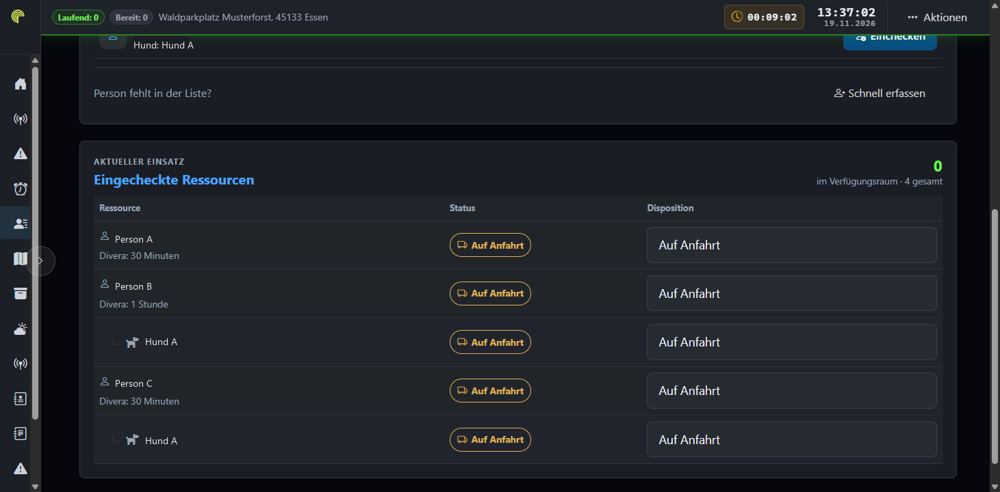
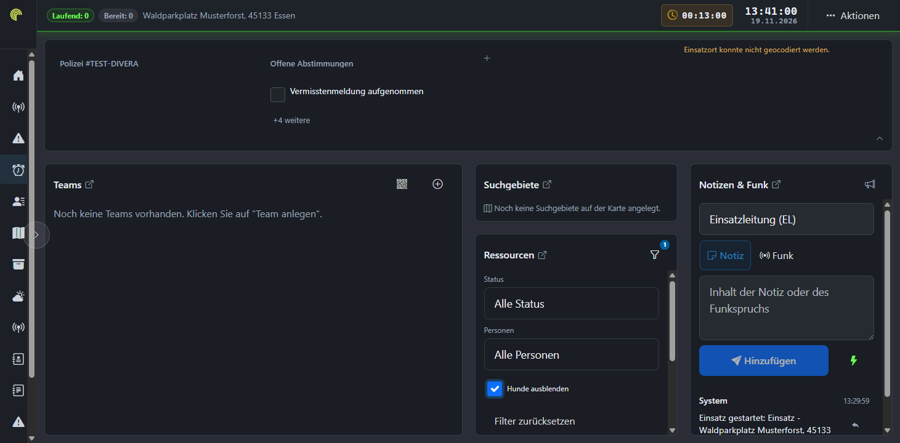
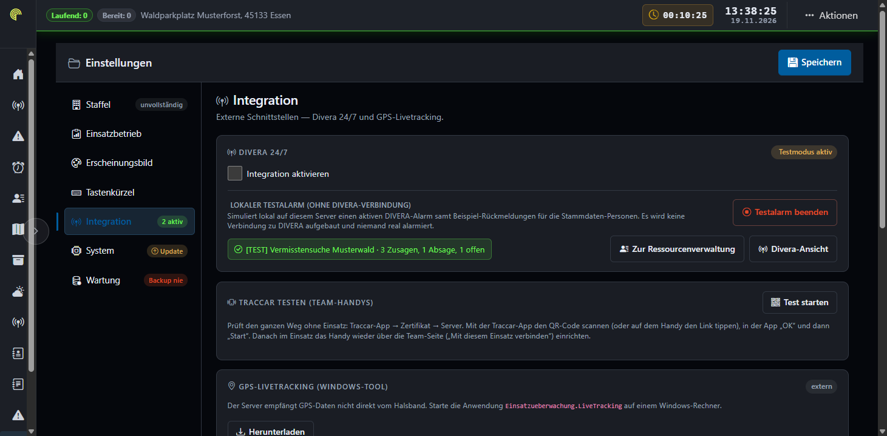

# Ressourcenverwaltung und DIVERA-Integration

## Zusammenfassung

Dieser Branch ergänzt eine einsatzbezogene Ressourcenverwaltung für Personen und Hunde und bindet deren Verfügbarkeit in Einsatzmonitor und Teamplanung ein. Die DIVERA-Integration übernimmt positive Rückmeldungen nicht mehr automatisch: Sie hebt passende Personen hervor und ermöglicht den Einzel- oder Sammel-Check-in. Ein lokaler Testalarm erlaubt die Prüfung des DIVERA-Ablaufs ohne Verbindung zum echten DIVERA-System.

## Änderungen

### Ressourcenverwaltung und Statusdisposition

- Personen und Hunde werden als getrennte Einsatzressourcen mit jeweils eigenem Status geführt.
- Check-in aus den Stammdaten mit den Startstatus **Auf Anfahrt** oder **Verfügbar**; Personenvorschläge erscheinen erst ab drei Suchzeichen.
- Schnellaufnahme neuer Personen und Hunde: Speicherung in den Stammdaten und direkter Check-in in den aktiven Einsatz.
- Statuswechsel pro Ressource: **Verfügbar**, **Vorübergehend abwesend**, **Pause**, **Auf Anfahrt**, **In Suche**, **Drohneneinsatz**, **Sonderauftrag** und **Abgemeldet**.
- Filter in der Ressourcenübersicht nach Status, Hundeführern, Personen ohne Hund und mit der Option, Hunde auszublenden. Status- und Personenfilter werden nur auf Personen angewendet. Hunde bleiben bei sichtbarem Hundeführer unabhängig von ihrem eigenen Status sichtbar; eigenständig eingecheckte Hunde werden durch Personenfilter nicht ausgeblendet. Nur die Option „Hunde ausblenden“ blendet Hunde aus.
- Versehentliche Check-ins lassen sich nach Bestätigung aus dem aktuellen Einsatz entfernen; die Stammdaten bleiben erhalten. Ressourcen, die einem Team oder Suchsektor zugeordnet sind oder gerade laufen beziehungsweise pausieren, sind bis zum Lösen der Zuordnung geschützt.
- Bei mehrfach verwendeten Ressourcen bleibt **In Suche** gesetzt, solange ein anderes Team die Ressource nutzt oder einer Suche zugeordnet ist.
- Ein **Sonderauftrag** benötigt eine Notiz, bevor der Status übernommen wird.
- Ein Suchauftrag setzt die zugewiesenen Personen und Hunde auf **In Suche**. Nach Abschluss werden sie wieder **Verfügbar**.
- Nur verfügbare Ressourcen können neuen Suchsektoren zugewiesen werden.
- Beim Einsatzende werden eingecheckte Personen und Hunde zusätzlich zu Teamzuweisungen anhand ihrer IDs in der Vor-Ort-Liste vorausgewählt.
- Ressourcenzustände werden über das bestehende Runtime-State-Persistenzereignis mitgespeichert.

### Hunde und Hundeführer

- Hunde können einem oder mehreren Hundeführern zugeordnet werden; bestehende Stammdatensätze mit einer einzelnen Zuordnung bleiben kompatibel.
- Ressourcenverwaltung und Einsatzmonitor zeigen Hunde am Eintrag der zugeordneten Hundeführer. Ein Hund behält dabei seinen eigenen Status und kann bei mehreren Hundeführern unter jedem erscheinen.
- Hunde können beim Check-in einer Person gezielt hinzugefügt werden.
- Personen- und Hundeeinträge unterstützen eine Organisation; Excel-Import und -Export übernehmen das Feld.
- Hunde verwenden in Ressourcenlisten das Hundesymbol der Kartenansicht.

### Einsatzmonitor und Teamstart

- Kompakte, flache Ressourcenübersicht mit Statusdisposition direkt im Einsatzmonitor.
- Filter über das Header-Icon: Ressourcenstatus, Hundeführer, Personen ohne Hund und Hunde ausblenden.
- Vor dem Start werden Ressourcenstatus an den Teammitgliedern angezeigt; während einer laufenden Suche werden diese Statusindikatoren ausgeblendet.
- Der Teamstart benennt blockierte Ressourcen verständlich und bietet ein gemeinsames Auflösungsmodal. Dort können mehrere Änderungen vorgemerkt werden: Status anpassen, ein Teammitglied entfernen oder die Verfügbarkeitsprüfung ausdrücklich für diesen Start übergehen.
- Änderungen werden gesammelt angewendet. Ein Übergehen gilt nur für den bestätigten Start; nach erfolgreichem Start greifen die normalen Suchstatus-Übergänge.

### DIVERA 24/7

- Positive Rückmeldungen zum verknüpften Alarm werden in der Ressourcenverwaltung hervorgehoben und priorisiert, aber nicht mehr automatisch eingecheckt.
- Einzel-Check-in verwendet den gewählten Startstatus; **Alle aus DIVERA einchecken** übernimmt noch nicht eingecheckte positive Rückmeldungen gesammelt als **Auf Anfahrt**. Bereits eingecheckte Ressourcen bleiben dabei unverändert.
- Rückmeldungen werden anhand der eindeutigen DIVERA-Benutzer-ID den aktiven Personenstammdaten zugeordnet.
- In **Einstellungen → Integration** kann ein lokaler Testalarm gestartet und beendet werden. Er liefert Beispielalarm und Beispiel-Rückmeldungen ausschließlich aus dem In-Memory-Testzustand. Währenddessen werden keine DIVERA-API-Aufrufe gesendet und keine echten Alarme ausgelöst. Personen ohne gepflegte DIVERA-ID können im Testmodus ebenfalls durch die Simulation abgebildet werden, ohne ihre Stammdaten zu ändern.
- Hilfetexte und Tests wurden an die manuelle Übernahme und den lokalen Testmodus angepasst.

## Screenshots

Die Screenshots stammen aus der lokalen Testumgebung. Sichtbare Personen- und Hundenamen wurden für die PR-Dokumentation anonymisiert.

### Ressourcenstatus und Hunde am Hundeführer

### Ressourcenfilter im Einsatzmonitor

### Lokaler DIVERA-Testalarm

## Verifikation

- `dotnet test src/Einsatzueberwachung.Tests --configuration Release --verbosity quiet --nologo` — **566/566 Tests bestanden**.
- `git diff --check` — ohne Beanstandungen.

## Manuelle Prüfschritte

- In **Einstellungen → Integration** den lokalen Testalarm starten. Sicherstellen, dass Testalarm und Beispiel-Rückmeldungen erscheinen, ohne einen echten DIVERA-Alarm auszulösen.
- Den Testalarm über **/divera** und beim Einsatzstart prüfen; bei einem aktiven, nicht anderweitig verknüpften Einsatz auch den direkten Übergang zur Ressourcenverwaltung testen.
- Positive Rückmeldungen einzeln und gesammelt einchecken. Prüfen, dass der Einzel-Check-in den ausgewählten Startstatus verwendet und bereits eingecheckte Ressourcen beim Sammel-Check-in unverändert bleiben.
- Personen und Hunde einchecken, mehrere Hundeführer-Zuordnungen prüfen sowie Status-, Hundeführer- und Ohne-Hund-Filter und **Hunde ausblenden** in der Ressourcenverwaltung und im Monitor verwenden.
- Unter drei Suchzeichen dürfen keine Personenvorschläge erscheinen; ab drei Zeichen prüfen, dass passende Treffer angezeigt werden. Einen neuen Hund mit Name und Rasse schnell erfassen und prüfen, dass Stammdaten und Einsatz-Check-in ohne Reload übernommen werden.
- Einen Check-in von Person und Hund jeweils abbrechen beziehungsweise bestätigen. Prüfen, dass der Stammdatensatz erhalten bleibt und zugeordnete Ressourcen erst nach dem Lösen der Team-/Sektorzuordnung entfernt werden können.
- Einen Teamstart mit nicht verfügbaren Ressourcen prüfen: mehrere Korrekturen vormerken, Teammitglied entfernen oder die Prüfung nur für diesen Start bestätigen.
- Beim Einsatzende prüfen, dass eingecheckte Personen und Hunde auch ohne Teamzuweisung vorausgewählt sind.
- Eine Ressource einem Suchsektor zuweisen und nach Abschluss prüfen, dass der Status von **In Suche** auf **Verfügbar** zurückgesetzt wird.
